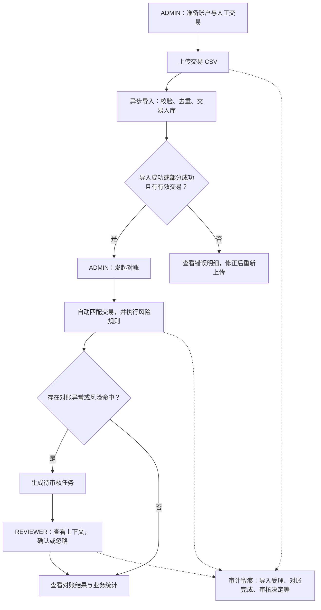
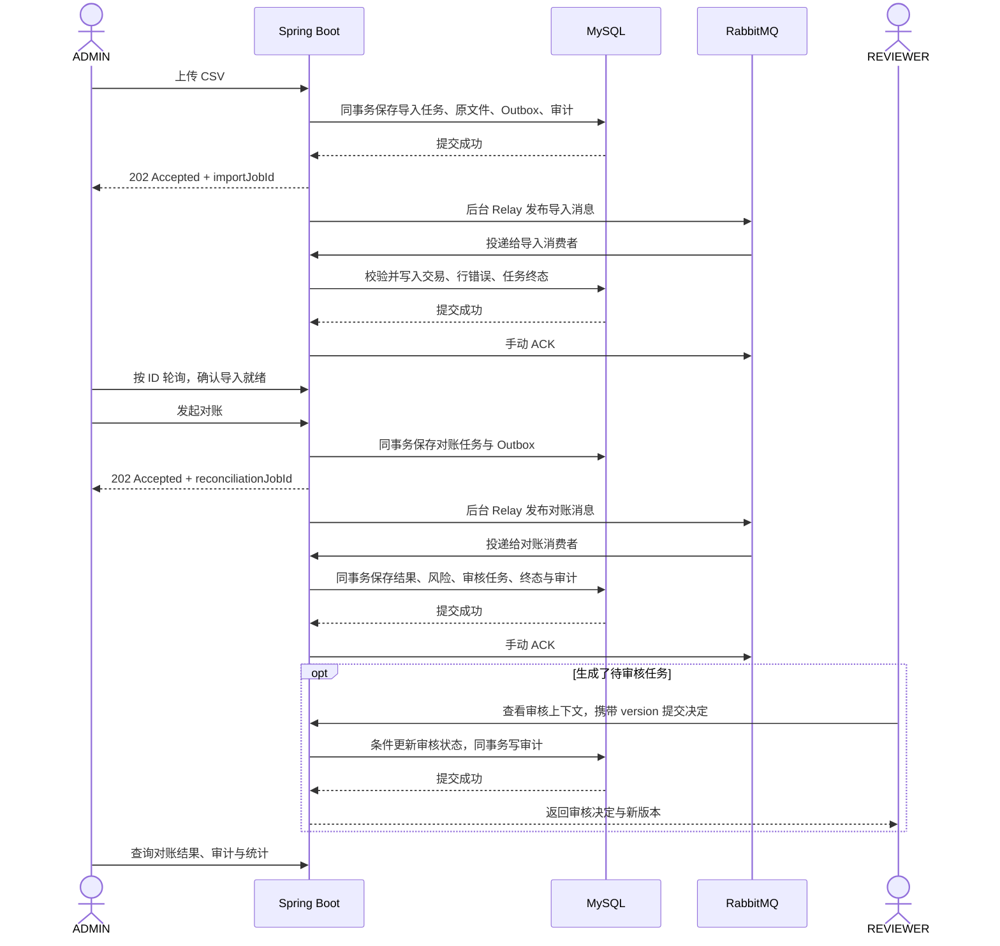
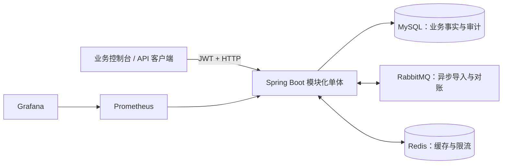

# FinGuard Core

基于 Spring Boot 的交易对账与风险审核平台，覆盖 **交易导入 → 自动对账 → 风险识别 → 人工审核 → 审计与统计** 的完整业务流程。

提供调用真实后端 API 的业务控制台，以及自动化测试、容器部署和监控配置。

**技术栈：** Java 17 · Spring Boot · Spring Security / JWT · MyBatis · MySQL · RabbitMQ · Redis · Flyway · Docker Compose · Prometheus / Grafana · GitHub Actions

## 业务功能

| 模块 | 能力 |
| --- | --- |
| 账户与交易 | 账户管理、人工交易、条件筛选、分页与软删除 |
| 文件导入 | CSV 校验、文件哈希去重、异步处理、逐行错误与任务查询 |
| 自动对账 | 精确与容差匹配，输出匹配、未匹配、重复和可疑结果 |
| 风险审核 | 大额、疑似重复、高频交易规则，独立审核角色与决策记录 |
| 审计与统计 | 关键操作留痕、业务聚合统计、缓存与失效处理 |
| 业务控制台 | 账户、交易、导入、对账、审核、审计统计及逐步场景演示 |

## 业务流程



对账由 ADMIN 在导入就绪后主动发起；对账异常与风险规则命中均可生成审核任务。审核决定保留原始交易和对账结果，另行记录处理结论。

<details>
<summary><strong>查看核心业务时序图</strong></summary>

下面展示正常业务链路。Outbox Relay 与消息消费者均运行在同一 Spring Boot 应用内；后台消息发布与 HTTP 响应独立进行。



文件重复、消息重投与审核冲突分支见 [架构说明](docs/ARCHITECTURE.md#3-核心业务流)。

</details>

## 架构与关键设计



- **异步可靠性：** 业务任务与 Outbox 事件同事务提交；消费者结合任务行锁、终态幂等、数据库唯一约束和手动 ACK 处理重复投递，失败采用有限重试与死信队列。
- **并发审核：** 使用状态与版本号条件更新，防止重复决策和并发覆盖；ADMIN 管理业务，REVIEWER 负责审核。
- **缓存降级：** MySQL 保存权威状态，Redis 用于统计缓存和固定窗口限流；故障时统计回源、限流 fail-open。
- **工程交付：** Flyway 管理数据库迁移，Testcontainers 隔离集成测试，CI 构建并发布完整 Git SHA 镜像，Linux 脚本支持保留数据卷的应用回滚。

设计取舍见 [架构说明](docs/ARCHITECTURE.md) 与 [架构决策](docs/adr/README.md)。

## 快速运行

环境要求：Java 17、Maven 3.9+、Docker Engine 与支持 `up --wait` 的 Docker Compose。

1. 将 `.env.example` 复制为 `.env`，填写服务密码和 JWT 密钥（至少 32 字节随机密钥的 Base64 编码）。
2. 首次创建演示账号时，在本地 `.env` 启用 `FINGUARD_AUTH_BOOTSTRAP_ENABLED=true`，并配置 ADMIN / REVIEWER 两组用户名与密码，变量见 [账号配置](docs/DEMO.md)。
3. 构建并启动：

```powershell
docker compose up -d --build --wait
docker compose ps
```

| 入口 | 地址 |
| --- | --- |
| 业务控制台 | [打开控制台](http://127.0.0.1:8080/demo/index.html) |
| Swagger UI | [查看接口](http://127.0.0.1:8080/swagger-ui/index.html) |
| 应用健康 | [健康检查](http://127.0.0.1:8080/actuator/health) |
| Prometheus | [指标查询](http://127.0.0.1:9090) |
| Grafana | [监控面板](http://127.0.0.1:3000) |

在控制台分别登录两个角色，按 [操作指南](docs/DEMO_OPERATING_GUIDE.md) 完成导入、对账和审核。页面操作会写入当前数据库。停止服务并保留数据使用 `docker compose down`。

Windows 源码启动、独立验收与 Linux 部署见 [演示手册](docs/DEMO.md)、[测试与验证](docs/VALIDATION.md) 和 [部署手册](docs/DEPLOYMENT.md)。

## 测试

Docker Engine 可用时，Java 集成测试会自动创建隔离的 Testcontainers 中间件：

```powershell
mvn.cmd -B -ntp clean test
node --test scripts/demo/tests/*.test.mjs
```

控制台还提供真实浏览器与隔离六服务验收入口，具体命令和历史验证范围见 [测试与验证](docs/VALIDATION.md)。

## 项目结构

```text
src/main/java/        业务模块与基础设施实现
src/main/resources/  应用配置、数据库迁移与业务控制台
src/test/            单元测试与集成测试
docs/                产品、架构、接口与运行文档
scripts/             演示、验收、部署与故障演练工具
ops/                 Prometheus 与 Grafana 配置
performance/         审计查询压测与 SQL 验证工具
security/            安全扫描工具与策略
```

## 文档

- [产品需求](docs/PRD.md) · [架构说明](docs/ARCHITECTURE.md) · [数据库设计](docs/DATABASE.md)
- [API 与权限](docs/API.md) · [演示操作指南](docs/DEMO_OPERATING_GUIDE.md) · [功能覆盖](docs/DEMO_COVERAGE.md)
- [部署与回滚](docs/DEPLOYMENT.md) · [监控与排障](docs/MONITORING.md) · [运维手册](docs/runbooks/README.md)
- [测试与验证](docs/VALIDATION.md) · [性能报告](docs/PERFORMANCE_REPORT.md) · [安全验证](docs/SECURITY_TEST_REPORT.md)

## 项目边界

本项目为个人开发的交易处理平台，使用演示数据。当前采用单机 Compose，未实现多可用区、TLS 终止或自动备份恢复；JWT 暂无刷新和主动撤销，Redis 故障期间限流暂时失效。性能验证限于审计日志默认分页，具体结果与适用范围见相应报告。
