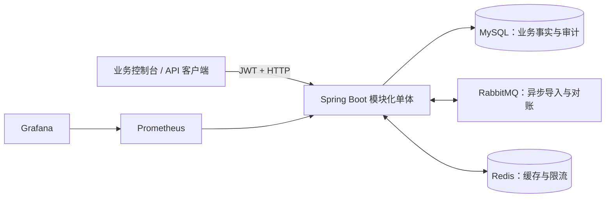
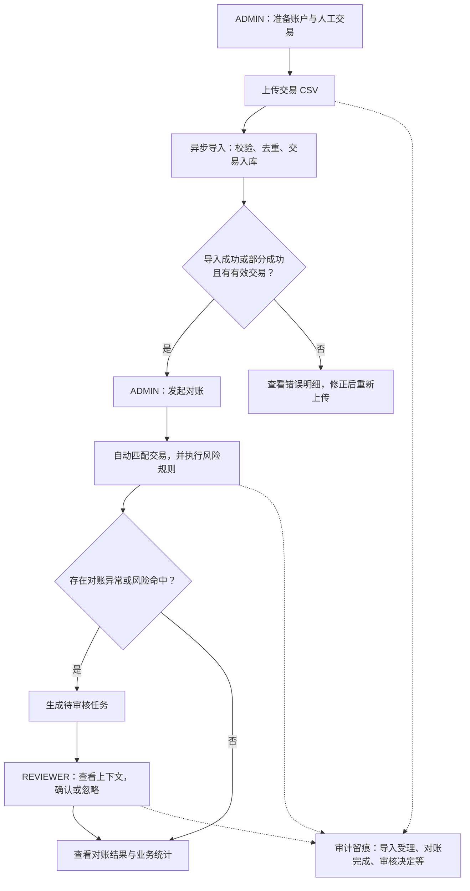
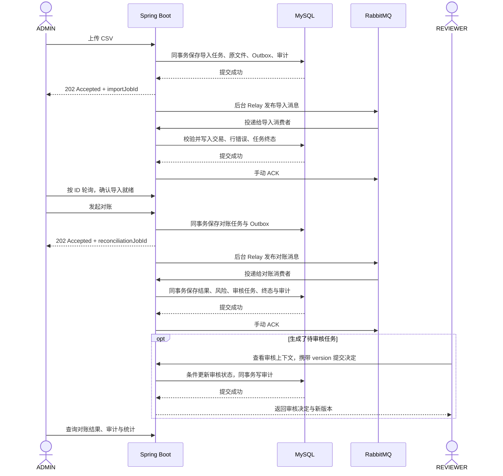
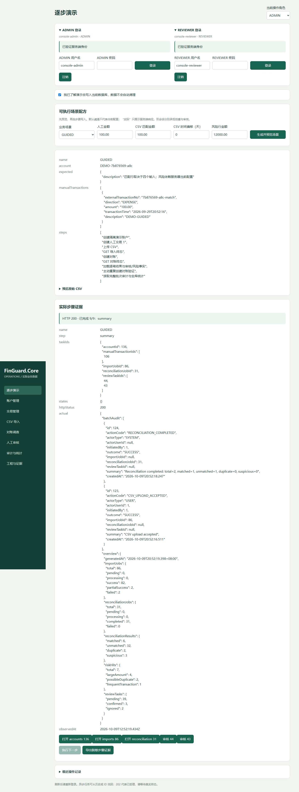

# FinGuard Core

**交易对账与风险审核平台** · Java 17 · Spring Boot · MySQL · RabbitMQ · Redis

[项目介绍](#项目介绍) · [系统架构](#系统架构) · [技术栈](#技术栈) · [功能特性](#功能特性) · [TODO](#todo) · [效果展示](#效果展示)

[项目结构](#项目结构) · [快速开始](#快速开始) · [Docker 快速部署](#docker-快速部署) · [使用场景](#使用场景) · [常见问题](#常见问题)

## 项目介绍

FinGuard Core 用于核对内部交易与外部 CSV 账单。系统异步导入账单，逐笔匹配内部交易，并把未匹配、疑似重复、风险规则命中等需要处理的记录交给审核人员。经办人可以按任务 ID 追踪导入和对账结果，审核人员可以查看交易上下文并提交决定，关键操作留有审计记录。

这是一个 Java 后端个人项目。仓库提供演示数据、连接真实后端 API 的业务控制台，以及容器部署、集成测试和监控配置。

## 系统架构



- **任务与消息一致性**：任务和 Outbox 事件在同一 MySQL 事务中提交。后台 Relay 发布消息，消费者使用任务行锁、终态判断和数据库唯一约束处理重复投递，并在事务提交后手动确认消息。
- **异常处理与审核**：异步消费支持有限重试和死信队列。经办与审核角色分离，提交审核决定时校验任务状态和版本，避免重复决定或覆盖。
- **缓存与观测**：Redis 用于统计缓存和固定窗口限流。缓存不可用时统计回源 MySQL，Redis 限流按 fail-open 策略降级。Prometheus 与 Grafana 用于查看应用指标。

### 业务流程与时序



ADMIN 在导入就绪后发起对账。对账异常与风险规则命中都可以生成审核任务，审核结论单独记录，便于回看原始交易和对账结果。

<details>
<summary><strong>查看核心业务时序图</strong></summary>

Outbox Relay 与消息消费者运行在同一 Spring Boot 应用内。后台发布消息与返回 HTTP 响应独立进行。



文件重复、消息重投与审核冲突分支见 [架构说明](docs/ARCHITECTURE.md#3-核心业务流)。

</details>

完整设计与事务细节见 [架构说明](docs/ARCHITECTURE.md) 和 [架构决策](docs/adr/README.md)。

## 技术栈

| 分类 | 技术 | 在项目中的用途 |
| --- | --- | --- |
| 后端 | Java 17、Spring Boot 3.5.16、Spring MVC、Maven | REST API、参数校验、事务与构建 |
| 认证与权限 | Spring Security、JWT | 区分 ADMIN 经办与 REVIEWER 审核 |
| 数据持久化 | MySQL 8.4、MyBatis-Plus 3.5.17、Flyway | 保存业务和审计数据，管理数据库迁移 |
| 异步与缓存 | RabbitMQ 4.3、Redis 8.2 | 异步导入和对账、有限重试、统计缓存与限流 |
| 控制台与接口文档 | HTML、CSS、JavaScript、SpringDoc OpenAPI / Swagger UI | 直接调用后端 API 演示业务，查看接口与请求格式 |
| 测试与交付 | JUnit 5、Testcontainers、Playwright、GitHub Actions、Docker Compose | 自动化测试、镜像构建和容器部署 |
| 可观测性 | Spring Boot Actuator、Micrometer、Prometheus、Grafana | 健康检查、指标采集与仪表盘 |

## 功能特性

| 模块 | 已实现能力 |
| --- | --- |
| 账户与交易 | 账户启停、人工交易维护、条件筛选、分页与软删除 |
| CSV 异步导入 | 文件哈希去重、逐行校验、行错误查询、成功与部分成功状态 |
| 自动对账 | 精确与容差匹配，输出匹配、未匹配、重复和可疑结果 |
| 风险识别与审核 | 大额、疑似重复、高频交易规则，按任务查看上下文并确认或忽略 |
| 审计与统计 | 查看导入受理、对账完成、审核决定等审计记录，以及业务汇总 |
| 业务控制台 | 逐步演示、独立业务工作区、按 ID 回看历史任务与导出脱敏步骤记录 |

## TODO

以下是后续改进方向。

- [ ] 为失败任务积压和死信队列增加可配置告警。
- [ ] 补充 MySQL 数据备份与恢复演练。
- [ ] 在可复现环境中补充导入、对账和审计查询的性能基准。

## 效果展示

业务控制台截图来自使用演示数据的真实后端运行。画面展示逐步演示、任务 ID、对账完成记录和业务统计。

<details>
<summary>展开控制台运行截图</summary>



</details>

## 项目结构

```text
finguard-core/
├── src/main/java/com/finguard/core/   # 账户、交易、导入、对账、风控、审核和审计
├── src/main/resources/               # 应用配置、数据库迁移与控制台静态资源
├── src/test/                         # 后端单元测试与集成测试
├── docs/                             # 产品、架构、接口及运维文档
├── sample-data/                      # 演示 CSV
├── scripts/
│   ├── demo/                         # 源码启动与浏览器验收
│   ├── acceptance/                   # 隔离环境全链路验收
│   ├── drills/                       # 依赖故障演练
│   └── linux/                        # Linux 部署与回滚
├── ops/                              # Prometheus 与 Grafana 配置
├── performance/                      # 审计查询压测工具
├── security/                         # 安全扫描工具与策略
├── docker-compose.yml                # 本地六服务运行环境
└── compose.linux.yml                 # Linux 部署配置
```

## 快速开始

1. 克隆仓库并复制本地配置模板。

   ```bash
   git clone https://github.com/jkwang1129/finguard-core.git
   cd finguard-core
   cp .env.example .env
   ```

2. 编辑 `.env`，替换 `replace-with-*` 占位值。为 `JWT_SECRET_BASE64` 填写至少 32 个随机字节的 Base64 编码。首次初始化演示账号时设置 `FINGUARD_AUTH_BOOTSTRAP_ENABLED=true`，并填写模板中的 ADMIN 和 REVIEWER 用户名、密码。已有账号可以直接登录。
3. 使用下方 Docker 方式启动六服务。需要在 Windows 上运行源码时，准备 Java 17、Maven 3.9+ 和 Docker，在仓库根目录启动。该脚本会启动 MySQL、RabbitMQ 和 Redis，再运行当前源码。

   ```powershell
   powershell -NoProfile -File scripts/demo/start-demo.ps1
   ```

4. 打开控制台，在两个登录区分别登录 ADMIN 与 REVIEWER。在「逐步演示」选 `GUIDED`，执行到对账完成，再到「人工审核」打开待审核任务并提交决定。各步骤与演示参数见 [控制台操作指南](docs/DEMO_OPERATING_GUIDE.md)。

## Docker 快速部署

准备 Docker Engine 及支持 `up --wait` 的 Docker Compose。镜像构建已包含 Java 和 Maven。

```bash
docker compose --env-file .env config --quiet
docker compose up -d --build --wait
docker compose ps
```

| 服务入口 | 默认地址 |
| --- | --- |
| 业务控制台 | [127.0.0.1:8080/demo/index.html](http://127.0.0.1:8080/demo/index.html) |
| Swagger UI | [127.0.0.1:8080/swagger-ui/index.html](http://127.0.0.1:8080/swagger-ui/index.html) |
| 应用健康检查 | [127.0.0.1:8080/actuator/health](http://127.0.0.1:8080/actuator/health) |
| Prometheus | [127.0.0.1:9090](http://127.0.0.1:9090) |
| Grafana | [127.0.0.1:3000](http://127.0.0.1:3000) |

停止服务并保留数据卷时执行 `docker compose down`。Linux 镜像部署与回滚见 [部署手册](docs/DEPLOYMENT.md)。

## 使用场景

| 场景 | 如何体验 |
| --- | --- |
| 核对外部账单 | ADMIN 准备内部交易，上传账单 CSV，等导入就绪后发起对账并查看逐笔结果。 |
| 调查异常交易 | REVIEWER 打开待审核任务，核对交易和风险上下文，再确认或忽略。 |
| 追踪一批数据的处理记录 | ADMIN 按导入或对账任务 ID 查询结果，再到审计页面查看关键动作。 |
| 验证可靠性 | 重传同一 CSV 查看原任务是否复用，或运行隔离验收检查消息重试和故障恢复。 |

## 常见问题

### 接口返回 HTTP 202 后，如何知道任务完成？

保存响应中的任务 ID，在控制台历史列表查看，或按 `Location` 轮询任务接口。导入成功或部分成功且存在有效交易时，ADMIN 可以发起对账。

### 为什么登录后不能上传 CSV 或提交审核？

上传和发起对账需要 ADMIN。提交审核决定需要 REVIEWER。出现 `401` 时检查账号或会话，出现 `403` 时检查当前操作角色。角色说明见 [API 文档](docs/API.md)。

### 为什么上传时出现行错误？

先查看导入任务的错误明细，再对照表头、金额、时间和方向字段检查。可使用仓库中的 [示例 CSV](sample-data/demo-import.csv) 作为格式参考。

### Docker 启动失败或网页打不开怎么办？

先运行 `docker compose ps` 和 `docker compose logs --tail=100 app`。端口冲突时可修改 `.env` 中的映射端口，例如 `FINGUARD_APP_PORT`，访问时使用对应端口。

### 在哪里运行测试？

准备 Java 17、Maven 和 Docker 后运行 `mvn test`，集成测试通过 Testcontainers 启动隔离依赖。控制台回归与隔离验收命令见 [测试与验证](docs/VALIDATION.md)。

## 更多文档

- [产品需求](docs/PRD.md) · [架构说明](docs/ARCHITECTURE.md) · [数据库设计](docs/DATABASE.md)
- [接口与权限](docs/API.md) · [演示操作指南](docs/DEMO_OPERATING_GUIDE.md) · [功能覆盖](docs/DEMO_COVERAGE.md)
- [部署与回滚](docs/DEPLOYMENT.md) · [监控与排障](docs/MONITORING.md) · [运维手册](docs/runbooks/README.md)
- [测试与验证](docs/VALIDATION.md) · [性能报告](docs/PERFORMANCE_REPORT.md) · [安全验证](docs/SECURITY_TEST_REPORT.md)
